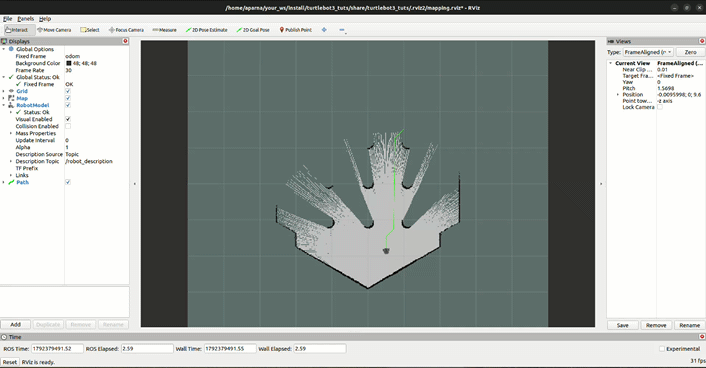

# ROS 2 TurtleBot3 Navigation & A* Path Planning

A ROS 2 project built on **Ubuntu 22.04 (Humble)** featuring TurtleBot3 simulation, mapping, and custom A* path planning in Gazebo and RViz.

## 🎥 Demo


### Simulation Views
- Gazebo Sim: `assets/gazebo_sim.webm`
- RViz View: `assets/rvizz_view.webm`
---

## 🛠️ Prerequisites & Dependencies
Make sure you have **ROS 2 Humble** and Gazebo installed on Ubuntu 22.04. Then install the required packages:

```bash
sudo apt update
sudo apt install ros-humble-gazebo-ros-pkgs ros-humble-turtlebot3*
```
###📥 Installation & Setup

1. Create a ROS 2 workspace (if you haven't already):

```bash
mkdir -p ~/your_ws/src
cd ~/your_ws/src
```

2. Clone this repository into your workspace src folder:

```bash
git clone [https://github.com/YOUR_USERNAME/YOUR_REPO_NAME.git](https://github.com/aparna7ap7/my-robot-navigation-project.git)
```
3. Build the workspace:

```bash
cd ~/your_ws
colcon build --symlink-install
```

4. Source your workspace and Gazebo environment:

```bash
source install/setup.bash
source /usr/share/gazebo/setup.sh
```

###🚀 Usage

Launch the mapping and A* path planning simulation:

```bash
ros2 launch turtlebot3_tuts mapping_astar.launch.py goal_x:=1.5 goal_y:=-1.0
```
